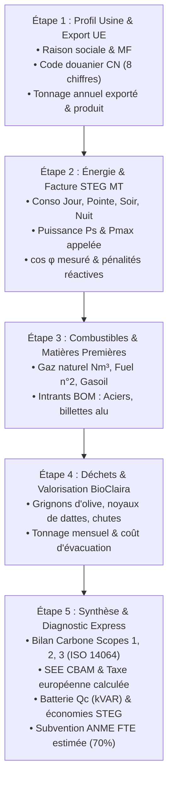

# SymbioCarb AI (منظومة سيمبيوكارب للذكاء الصناعي والكربون)
> **Plateforme SaaS B2B Enterprise de Décarbonation Industrielle, Efficacité Énergétique STEG et Conformité CBAM pour la Tunisie**  
> *Conformité CBAM UE (MACF) • Optimisation Tarifaire STEG MT/HT • Subventions ANME FTE • Symbiose Circulaire BioClaira • Trilingue FR / EN / AR-TN (RTL)*

[](https://symbiocarb.vercel.app)
[](https://nextjs.org/)
[](https://www.typescriptlang.org/)
[](https://deepmind.google/technologies/gemini/)
[](https://supabase.com/)

---

## 📑 Sommaire
1. [Vision & Contexte Industriel Tunisien](#-vision--contexte-industriel-tunisien)
2. [Architecture Technique & Stack](#-architecture-technique--stack)
3. [Parcours d'Audit Express en 5 Étapes (Le Cœur du Produit)](#-parcours-daudit-express-en-5-étapes)
4. [Les 6 Modules Opérationnels Déployés](#-les-6-modules-opérationnels-déployés)
   - [Module 1 : Assistant d'Audit & Diagnostic Express (`/audit`)](#module-1--assistant-daudit--diagnostic-express-audit)
   - [Module 2 : Optimiseur STEG MT & Dimensionneur Cos φ (`/energy`)](#module-2--optimiseur-steg-mt--dimensionneur-cos-φ-energy)
   - [Module 3 : Moteur CBAM UE & Exportateur XML/PDF (`/cbam`)](#module-3--moteur-cbam-ue--exportateur-xmlpdf-cbam)
   - [Module 4 : Symbiose Circulaire & Pyrolyse BioClaira (`/symbiosis`)](#module-4--symbiose-circulaire--pyrolyse-bioclaira-symbiosis)
   - [Module 5 : Document AI Multimodal Factures STEG (`/ocr`)](#module-5--document-ai-multimodal-factures-steg-ocr)
   - [Module 6 : Centre de Ressources Réglementaires (`/blog`)](#module-6--centre-de-ressources-réglementaires-blog)
5. [Modes d'Exploitation : Usine Réelle vs Exemples Démo](#-modes-dexploitation--usine-réelle-vs-exemples-démo)
6. [Moteur Trilingue Natif (FR / EN / AR-TN) & Gestion RTL](#-moteur-trilingue-natif--gestion-rtl)
7. [Design System "Obsidian Dark & Carbon Precision"](#-design-system-obsidian-dark--carbon-precision)
8. [Guide d'Installation & Déploiement Local](#-guide-dinstallation--déploiement-local)
9. [Variables d'Environnement Requises](#-variables-denvironnement-requises)

---

## 🇹🇳 Vision & Contexte Industriel Tunisien

Plus de **70% des exportations industrielles tunisiennes** sont destinées au marché de l'Union Européenne (secteurs mécanique, électrique, câblage, textile, agroalimentaire, huileries, dattes, ciments et céramiques). Les PME manufacturières tunisiennes sont confrontées à quatre contraintes économiques et réglementaires majeures :

1. **Le Mécanisme d'Ajustement Carbone aux Frontières de l'UE (CBAM / MACF - Règlement 2023/956) :**  
   Les industriels exportant vers l'Europe doivent déclarer leurs émissions spécifiques directes et indirectes ($SEE$ en $\text{tCO}_2\text{e}/\text{t}$ de produit fini) sous peine de lourdes taxes douanières indexées sur le cours des quotas EU ETS (~85 €/t).
2. **La Facturation Électrique STEG MT/HT & les Pénalités Énergétiques :**  
   Les usines en Moyenne Tension subissent une tarification horaire quadruple (*Jour, Pointe, Soir, Nuit*). Les heures de Pointe (tarif de 0.412 TND/kWh) ainsi que les pénalités pour facteur de puissance dégradé ($\cos \varphi < 0.80$) et dépassement de puissance souscrite gonflent artificiellement la facture de 15% à 35%.
3. **Le Gisement Inexploité de Déchets Agro-Industriels :**  
   La Tunisie produit chaque année plus de **300 000 tonnes de grignons d'olive** et **100 000 tonnes de noyaux de dattes**. Souvent rejetés ou brûlés à l'air libre, ces résidus représentent une valeur marchande majeure via la pyrolyse en charbon actif ou biochar d'amendement.
4. **La Complexité et la Lenteur des Audits Traditionnels :**  
   Réaliser un audit énergétique ISO 50001 et un bilan carbone ISO 14064 via un cabinet de conseil externe exige généralement **4 à 6 mois** de travail de terrain et coûte entre 15 000 et 40 000 TND. **SymbioCarb AI automatise ce diagnostic complet en 5 minutes**.

---

## 🛠 Architecture Technique & Stack

```
┌────────────────────────────────────────────────────────────────────────┐
│                        FRONTEND & CORE FRAMEWORK                       │
│  Next.js 15 (App Router, Server Actions) • TypeScript Strict           │
│  Tailwind CSS • shadcn/ui • Framer Motion • Lucide Icons               │
│  Recharts Data Viz • Thème permanent Obsidian Dark haute précision    │
├────────────────────────────────────────────────────────────────────────┤
│                       SOLVEURS DÉTERMINISTES                           │
│  • steg-tariffs.ts : Arrêté tarifaire officiel STEG MT (4 tranches)   │
│  • cos-phi-solver.ts : Formule de Boucherot & Dimensionnement Qc kVAR  │
│  • cbam-calculator.ts : SEE & Passif financier CBAM (Règlement UE)    │
│  • bioclaira-simulator.ts : Cinétique de pyrolyse & bilan matière      │
├────────────────────────────────────────────────────────────────────────┤
│                           INTELLIGENCE ARTIFICIELLE                    │
│  • Google Gemini 2.5 Flash Vision : Extraction OCR factures STEG/SONEDE│
│  • text-embedding-004 (768d) : Matching vectoriel des nomenclatures BOM│
├────────────────────────────────────────────────────────────────────────┤
│                       BASE DE DONNÉES & AUTHENTIFICATION               │
│  • Supabase (PostgreSQL 15 + extension pgvector)                       │
│  • Authentification Google OAuth 2.0 & Démo 1-Clic sans friction       │
└────────────────────────────────────────────────────────────────────────┘
```

---

## ⚡ Parcours d'Audit Express en 5 Étapes

Accessible via le bouton **"Audit Express"** dans la barre de navigation ou via l'URL [`/audit`](https://symbiocarb.vercel.app/audit), l'assistant guidé remplace un diagnostic de 6 mois par un flux déterministe en 5 étapes :



### Fonctionnalités de confort pour le client industriel :
- **Remplissage rapide par profils sectoriels certifiés :** 3 boutons permettent d'appliquer instantanément les données moyennes tunisiennes étalons (CETIC / ANME) :
  - ⚙️ *Métallurgie (Ben Arous)* : profil orienté usinage, aciers et pénalités CBAM.
  - 🫒 *Huilerie (Sfax)* : profil forte puissance de pointe et valorisation des grignons.
  - 🌴 *Dattes (Tozeur)* : profil agroalimentaire avec pyrolyse des noyaux de dattes.
- **Jauge d'état d'avancement (Readiness Score) :** Indicateur dynamique calculant le taux de complétude du dossier réglementaire de 0% à 100%.
- **Synchronisation automatique "Mon Usine Réelle" :** Dès la fin du parcours, toutes les valeurs saisies par le client deviennent les données actives du mode réel, recalculant l'ensemble de la plateforme en temps réel.

---

## 📦 Les 6 Modules Opérationnels Déployés

### Module 1 : Assistant d'Audit & Diagnostic Express (`/audit`)
- Restitution instantanée des indicateurs d'émissions (Scope 1 direct, Scope 2 STEG MT, Scope 3 intrants).
- Calcul du **SEE** (*Specific Embedded Emissions*) en $\text{tCO}_2\text{e}/\text{t}$ de produit fini.
- **Génération en 1 clic de l'Attestation Officielle d'Audit (PDF)** prête pour l'impression papier ou l'export numérique vectoriel.
- **Téléchargement direct de la Déclaration XML Officielle CBAM** conforme aux schémas XSD du Registre Transitoire de la Commission Européenne.

### Module 2 : Optimiseur STEG MT & Dimensionneur Cos φ (`/energy`)
- **Décomposition des 4 tranches horaires :** Jour (0.248 TND), Pointe (0.412 TND), Soir (0.235 TND), Nuit (0.188 TND).
- **Dimensionnement déterministe de la batterie de condensateurs :**
  $$Q_c = P_{\text{actif}} \times (\tan \varphi_{\text{actuel}} - \tan \varphi_{\text{cible}})$$
  où $\varphi_{\text{cible}}$ correspond à un $\cos \varphi$ optimal de 0.95.
- Élimination garantie de 100% des pénalités d'énergie réactive et calcul du temps de retour sur investissement (TRI) du banc de compensation.
- Calcul de l'éligibilité aux **subventions ANME (FTE - 70% des frais d'audit énergétique)** et primes d'investissement.

### Module 3 : Moteur CBAM UE & Exportateur XML/PDF (`/cbam`)
- Modélisation de l'exposition fiscale sous le Règlement (UE) 2023/956 :
  $$\text{Passif CBAM (€)} = \max(0, SEE - \text{Benchmark UE}) \times \text{Volume Exporté (t)} \times 85 \text{ €/t}$$
- Prise en charge des codes douaniers de la nomenclature combinée (CN à 8 chiffres : acier, aluminium, engrais, ciment).
- Prise en compte du mix électrique tunisien officiel (0.473 $\text{kgCO}_2\text{e}/\text{kWh}$).
- Visualisation interactive du rapport d'audit avec hash d'intégrité SHA-256 et statut d'accréditation TUNAC / ISO 14065.

### Module 4 : Symbiose Circulaire & Pyrolyse BioClaira (`/symbiosis`)
- Modélisation thermodynamique de pyrolyse lente et activation chimique ($\text{H}_3\text{PO}_4$ / Vapeur d'eau) pour les biomasses tunisiennes :
  - **Noyaux de dattes Deglet Nour :** production de charbon actif de qualité pharmaceutique/purification (BET > 1 150 $\text{m}^2/\text{g}$, indice d'iode > 980 mg/g).
  - **Grignons d'olive humides ou secs :** production de biochar d'amendement des sols agricoles tunisiens et biocombustible solide.
- Bilan matière : tonnes de biochar/an, séquestration négative de carbone ($\text{tCO}_2$ évitées par rapport à la décharge ou lagunage anaérobie).
- Carte géographique interactive connectant les zones industrielles clés : Ben Arous, Mghira, Sfax Thyna, Tozeur, Bizerte, Gabès.

### Module 5 : Document AI Multimodal Factures STEG (`/ocr`)
- Propulsé par **Google Gemini 2.5 Flash Vision**.
- Analyse de factures réelles papier de la STEG (Moyenne Tension) et de la SONEDE (eau industrielle).
- Extraction structurée avec validation par schéma strict : index compteur, consommations Jour/Pointe/Soir/Nuit, énergie réactive (kVARh), puissance atteinte, FTR, redevance municipale et montant total TTC.
- Interface en écran partagé (*split-screen*) avec visualiseur de document et scores de confiance par champ extrait.

### Module 6 : Centre de Ressources Réglementaires (`/blog`)
Un hub complet d'articles spécialisés et de références officielles pour les ingénieurs et directeurs d'usine :
1. **Règlement UE 2023/956 (CBAM / MACF) :** Guide complet des règles de déclaration pour les exportateurs tunisiens.
2. **Norme ISO 14064-1:2018 :** Structuration du périmètre organisationnel et des Scopes 1, 2 et 3.
3. **ISO 14067 :** Calcul de l'empreinte carbone des produits (PCF) et analyse de cycle de vie (ACV).
4. **Optimisation STEG MT & ISO 50001 :** Guide de suppression des pénalités réactives et effacement de pointe.
5. **Subventions ANME & Fonds FTE :** Prise en charge à 70% de l'audit énergétique industriel en Tunisie.
6. **Modèles de Pyrolyse BioClaira :** Valorisation des résidus oléicoles et phœnicicoles en charbon actif.

---

## 🏢 Modes d'Exploitation : Usine Réelle vs Exemples Démo

Le sélecteur d'usine situé dans la barre de navigation sépare rigoureusement deux contextes opérationnels :

```
┌────────────────────────────────────────────────────────┐
│  🏢 DONNÉES RÉELLES DE L'USINE CLIENT                 │
│  └─ 🏢 Mon Usine (Données Réelles Personnalisées)       │  <- [Mode Réel]
├────────────────────────────────────────────────────────┤
│  🎮 DONNÉES DÉMO (EXEMPLES & ARCHÉTYPES TYPES)        │
│  ├─ Exemple 1 : Ben Arous (Mécanique & CBAM)           │  <- [Démo]
│  ├─ Exemple 2 : Tozeur (Dattes & BioClaira)           │  <- [Démo]
│  └─ Exemple 3 : Sfax (Huilerie & Pointe STEG)          │  <- [Démo]
└────────────────────────────────────────────────────────┘
```

- **Mode Réel (`custom`) :** Conserve en persistance locale (`localStorage`) et dans la session Supabase les données exactes renseignées lors de l'Audit Express par le client.
- **Modes Démo (`benarous`, `tozeur`, `sfax`) :** Permettent aux auditeurs et jurys d'explorer instantanément des cas industriels tunisiens types sans nécessiter de saisie préalable.

---

## 🌍 Moteur Trilingue Natif & Gestion RTL

La plateforme est nativement conçue pour l'écosystème industriel tunisien :
1. **Français (`fr`) :** Langue de travail par défaut des ingénieurs d'exploitation, des audits STEG et des dossiers ANME.
2. **English (`en`) :** Pour les donneurs d'ordre européens, les auditeurs CBAM internationaux et les déclarations douanières TAXUD.
3. **العربية التونسية (`ar-TN`) :** Arabe technique avec Darija industrielle pour les directeurs de sites, chefs d'équipes et propriétaires d'huileries.

### Prise en charge RTL automatique :
- En sélectionnant `تونسية`, l'attribut `<html dir="rtl" lang="ar-TN">` est appliqué sans rechargement de page.
- Inversion symétrique automatique des barres latérales, tableaux, formulaires et indicateurs grâce aux classes logiques Tailwind (`ms-*`, `me-*`, `ps-*`, `pe-*`).
- Typographie typique arabe optimisée : police **`Cairo`** et **`IBM Plex Sans Arabic`** pour la lecture, associée à **`JetBrains Mono`** pour les grandeurs d'ingénierie et unités physiques (kWh, kVAR, tCO₂e).

---

## 🎨 Design System "Obsidian Dark & Carbon Precision"

Conçu selon les standards visuels les plus exigeants (inspiré des dashboards d'ingénierie de pointe tels que *Linear*, *Vercel* et *Watershed*) :
- **Fond principal :** Noir obsidienne profond (`#090D16`).
- **Cartes & Panneaux :** Verre fumé surélevé (`#111827` avec bordures subtiles `rgba(255, 255, 255, 0.08)`).
- **Code couleur sémantique industriel :**
  - 🟢 **Vert Émeraude (`#10B981`) :** Réductions carbone, crédits recyclage, économies financières nettes.
  - 🟡 **Ambre Chaud (`#F59E0B`) :** Avertissements heures de pointe STEG, puissance souscrite en limite.
  - 🔴 **Rouge Électrique (`#EF4444`) :** Pénalités $\cos \varphi < 0.80$, dépassements de puissance, passif financier taxe CBAM.
- **Rapports d'impression papier :** Le composant `AuditReportDialog` applique un format fond blanc contrasté (`bg-white text-slate-900`) via la règle `@media print` pour garantir une impression officielle propre et économe en encre.

---

## 🚀 Guide d'Installation & Déploiement Local

### Pré-requis
- **Node.js** : version 20.x ou ultérieure (LTS recommandée).
- **npm** ou **pnpm**.
- Un compte **Supabase** (avec l'extension `pgvector` activée).
- Une clé d'API **Google Gemini** (Gemini 2.5 Flash).

### 1. Cloner le projet
```bash
git clone https://github.com/SeifElouaer/symbiocarb.git
cd symbiocarb
```

### 2. Installer les dépendances
```bash
npm install --legacy-peer-deps
```

### 3. Configurer l'environnement
Copiez le fichier d'exemple et renseignez vos clés :
```bash
cp .env.example .env.local
```

### 4. Lancer le serveur de développement
```bash
npm run dev
```
Ouvrez ensuite [http://localhost:3000](http://localhost:3000) dans votre navigateur.

### 5. Vérifier la compilation TypeScript
```bash
npm run build
```

---

## 🔑 Variables d'Environnement Requises

Dans votre fichier `.env.local` :

```env
# Supabase Database & Auth (pgvector)
NEXT_PUBLIC_SUPABASE_URL="https://ctybhgfawzchcqzboiau.supabase.co"
NEXT_PUBLIC_SUPABASE_ANON_KEY="eyJhbGciOiJIUzI1NiIsInR5cCI6IkpXVCJ9..."
SUPABASE_SERVICE_ROLE_KEY="eyJhbGciOiJIUzI1NiIsInR5cCI6IkpXVCJ9..."

# Google Gemini API (Vision Multimodale & Document AI)
GEMINI_API_KEY="AIzaSy..."

# Paramètres Applicatifs
NEXT_PUBLIC_APP_URL="https://symbiocarb.vercel.app"
NEXT_PUBLIC_DEFAULT_LOCALE="fr"
```

---

## 🌐 Déploiement en Production

La plateforme est déployée et mise à jour en continu sur le cloud Vercel :

👉 **[https://symbiocarb.vercel.app](https://symbiocarb.vercel.app)**

---

*Développé avec rigueur d'ingénierie pour accélérer la transition écologique et la compétitivité internationale de l'industrie tunisienne.*
