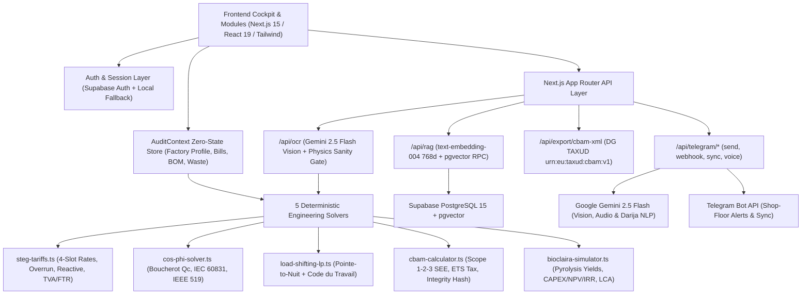

# SymbioCarb AI — Comprehensive Platform & Engineering Dossier

> **Purpose of This Document:** Complete technical, functional, mathematical, commercial, and strategic briefing on **SymbioCarb AI** (*منظومة سيمبيوكارب للذكاء الصناعي والكربون*), compiled directly from the production codebase so an AI assistant (such as Claude) or founding team can build an investor-grade / hackathon-winning pitch presentation without ambiguity.

---

## 1. Executive Summary & Pitch Identity

| Attribute | Verified Platform Details |
| :--- | :--- |
| **Platform Name** | **SymbioCarb AI** (*منظومة سيمبيوكارب للذكاء الصناعي والكربون*) |
| **Category** | **Zero-CAPEX B2B DeepTech SaaS** (Industrial Decarbonization, Energy Cost Optimization & Circular Economy) |
| **Target Market** | Tunisian & Euro-Med export-oriented manufacturing and agro-industrial SMEs (Medium & High Voltage STEG subscribers) |
| **Production URL** | `https://symbiocarb.vercel.app` |
| **Core Languages** | Trilingual Native UI with zero-reload RTL switching: **French (`fr`)**, **English (`en`)**, **Tunisian Arabic / Darija (`ar-TN`)** |
| **Core Promise** | Compress a **4–6 month, 15,000–40,000 TND** consulting audit into a **5-minute, zero-CAPEX** continuous diagnostic platform |

### The 3-Pillar Value Proposition
1. **Automate EU CBAM Carbon Compliance (Regulation EU 2023/956):** Computes product-level **Specific Embedded Emissions (`SEE`)** across Scope 1 (direct combustion), Scope 2 (STEG grid electricity), and Scope 3 (precursor Bill of Materials matched via multilingual semantic vector RAG), generating **EU DG TAXUD XML declarations** and **printable ISO 14064-1 pre-audit PDF certificates**.
2. **Mathematically Slash STEG Medium/High-Voltage Electricity Bills:** Parses official STEG invoices via **Gemini 2.5 Flash Vision OCR** (verified by an arithmetic physics gate) or batch CSV import, then optimizes the 4 STEG time-of-use slots (*Jour, Pointe, Soir, Nuit*), sizes **reactive power capacitor banks ($\cos\varphi$)** with IEC 60831 thermal derating & IEEE 519 harmonic filtering, models **Pointe-to-Nuit load shifting** net of Tunisian labor law night premiums, and maps **ANME FTE (70% audit / 20% equipment)** & **FODEP** subsidies.
3. **Turn Industrial & Agro-Industrial Waste into Circular Revenue (`BioClaira` — Pack Gold):** An intentionally decoupled add-on module that models thermochemical pyrolysis and activation of Tunisian agro-waste (*noyaux de dattes*, *grignons d'olive*, *margines*) as well as metal turnings and polymer scrap into high-value **activated carbon**, **biochar**, and **syngas/briquettes** with full NPV/IRR/CAPEX and lifecycle carbon avoidance math.

### Core Architectural Philosophy
- **Zero-CAPEX:** Zero IoT meters, zero sensor installation, zero factory shutdowns. Works immediately from existing STEG paper/PDF bills, CSV histories, and purchasing BOMs.
- **Strict Zero-State Data Integrity:** Authenticated workspaces initialize strictly at `0` with zero pre-injected mock numbers or fake company personas (`src/lib/audit/audit-context.tsx`). Every KPI, chart, and percentage is computed purely from the user's real inputs.
- **Deterministic Engineering + Guardrailed AI:** LLMs never invent financial, tax, or physics outputs. **Google Gemini 2.5 Flash** handles unstructured ingestion (Vision OCR, multilingual BOM embeddings, Tunisian Darija voice/text), while **5 deterministic TypeScript solvers** execute 100% of electrical, thermodynamic, tax, and financial math.

---

## 2. The Problem & Macro Urgency (Why Tunisia, Why 2026)

### 2.1 The EU CBAM Border Tax Shock (Regulation EU 2023/956 & 2023/1773)
- Over **70% of Tunisian industrial exports** are destined for the European Union (mechanical machining, steel & aluminum profiles, automotive wiring/cabling, fertilizers, cement, and agro-industrial goods).
- **2025–2026 Regulatory Cliff:**
  - Since **January 1, 2025**, the EU ended unrestricted reliance on flat default estimates, requiring **real verified installation-level emissions** (`SEE` in $\text{tCO}_2\text{e}/\text{t}$) and standardized **XML communications** for EU customs declarants (DG TAXUD).
  - Entering **definitive financial CBAM enforcement in 2026**, EU importers must purchase CBAM certificates priced against the **EU ETS carbon market (~85 €/$\text{tCO}_2\text{e}$)**.
  - Without real verified `SEE` data, Tunisian suppliers risk getting slapped with punitive **EU JRC default values** (worst-performing percentiles + markups), threatening EU OEM subcontracting contracts.

### 2.2 Crushing STEG Medium-Voltage Tariffs & Invisible Electrical Penalties
- Tunisian factories on STEG **Moyenne Tension Postes Horaires (`MT_POSTES_HORAIRES`)** face 4 time-of-use slots where peak electricity (**Pointe**: `0.412 TND/kWh`) is **+119% more expensive** than off-peak night power (**Nuit**: `0.188 TND/kWh`).
- Worse, poorly compensated inductive loads (motors, induction furnaces, CNC machines, chillers) cause:
  - **Reactive Power Penalties:** When $\cos\varphi < 0.85$ ($\tan\varphi > 0.62$), STEG bills **0.045 TND per excess kVARh** plus cascade TVA.
  - **Subscribed Power Overrun Penalties:** Exceeding *Puissance Souscrite* ($P_{\text{max}} > P_s$) incurs **25.000 TND/kVA/month**.
- Together, peak-hour concentration, low $\cos\varphi$, and power overruns inflate industrial electricity bills by **15% to 35%**.

### 2.3 Massive Untapped Agro-Industrial Biomass & Import Dependence
- Tunisia produces **300,000–350,000 tonnes/year of olive pomace** (*grignons d'olive*) and **45,000–100,000 tonnes/year of date pits** (*noyaux de dattes*), alongside liquid *margines* and industrial metal/polymer scrap.
- Factories currently pay **disposal/landfill fees** (or dump/burn residue, generating fugitive methane), while Tunisia simultaneously spends scarce foreign currency importing fossil-coal activated carbon at **6,500–9,000 TND/tonne** (modeled baseline in BioClaira: `7,500 TND/t`).

### 2.4 The Traditional Consulting Bottleneck
- Under **Tunisian Law n° 2004-72**, industrial sites consuming **> 500 TEP/year** must undergo mandatory energy audits every 5 years.
- Traditional ISO 50001 energy audits and ISO 14064 carbon inventories via external consultants take **4 to 6 months**, cost **15,000 to 40,000 TND**, and produce static PDFs that become obsolete immediately — leaving SMEs unprepared for quarterly CBAM reporting.
- Existing global ESG SaaS platforms (Watershed, Sweep, Greenly) are priced in EUR/USD, lack native STEG 4-slot tariffs, ignore ANME FTE / Tunisian labor law constraints, and offer zero Arabic/Tunisian Darija shop-floor UX.

---

## 3. Product Architecture & Strategic Design Decisions

### 3.1 Four Intentional Product Decisions (High Pitch Leverage)
1. **Zero-CAPEX Software Ingestion:** Instead of selling IoT sub-meters, SymbioCarb AI extracts telemetry directly from legally binding **STEG bills** (PDF/smartphone photos via OCR or multi-month CSV exports) and **supplier BOMs**. Time-to-first-diagnostic drops from months to minutes.
2. **Strict Zero-State Overhaul (`commit b3f17ba`):** Earlier prototypes included static demo archetypes. In the latest production architecture (`src/lib/audit/audit-context.tsx`), **all mock factory presets were stripped from authenticated sessions**. Every account starts at exact `0`, isolated per user (`symbiocarb_factory_data_<userId>`), with explicit zero/NaN guards so auditors and CFOs trust every number.
3. **Hybrid AI + Deterministic Architecture:** Generative AI is strictly bounded to **perception and language** (OCR extraction, 768-dim vector search, Darija NLP). All compliance, electrical, financial, and thermodynamic calculations run in **pure, auditable TypeScript math functions**, backed by an arithmetic sanity gate in `/api/ocr`.
4. **Decoupled Circular Add-On (`BioClaira` as Pack Gold):** Waste valorization is kept in its own separate module (`/symbiosis`) rather than mixed into initial STEG/CBAM onboarding. Why? (a) It keeps core energy/CBAM onboarding fast for factories with minimal solid waste, (b) it ensures circular carbon avoidance credits never contaminate mandatory EU CBAM tax calculations, and (c) it creates a natural **high-ARPU Pack Gold upsell** (`1,090 TND/mo` vs `490 TND/mo` Pro).

### 3.2 System Architecture Diagram

---

## 4. Complete Platform Walkthrough (Pages, Modals & User Journey)

### 4.1 Public SaaS Landing Page (`src/app/page.tsx` — Unauthenticated View)
- **Hero Section:** Zero-CAPEX positioning (*"Conformité CBAM, Facture STEG & Revenus Circulaires"*), direct CTAs for **Create Company Account** and **Sign In**, and 3 engineering pillars (`01 / Zéro-CAPEX`, `02 / Optimisation STEG`, `03 / Conformité CBAM UE`).
- **Regulatory Credibility Block:** Direct cards linking to the knowledge hub for **CBAM UE 2023/956**, **ISO 14064-1:2018**, and **STEG MT & ANME FTE 70%**.
- **Startup Mission Block:** Explains SymbioCarb AI's DeepTech engineering roots, zero-CAPEX philosophy, mathematical rigor, and BioClaira circular extension.
- **Transparent B2B SaaS Pricing Section:** Interactive **Monthly / Annual (-20%)** billing toggle displaying **Pack Starter PME**, **Pack Exportateur Pro** (highlighted), and **Pack Gold + BioClaira**.

### 4.2 Authentication & 2-Step Zero-State Factory Onboarding
- **`AuthModal.tsx` & `auth-context.tsx`:**
  - Supports **Google OAuth 2.0** (`signInWithOAuth` via Supabase) and **Email/Password** (`signUp`/`signInWithPassword`), with automatic resilient local account/session persistence if network or Supabase anon credentials are unavailable in offline/local environments.
- **`FactoryOnboardingModal.tsx` (Triggered automatically on first login):**
  - **Step 1 — Identity & Scope:** Collects *Raison sociale*, *Matricule Fiscal (MF)*, Governorate, Industrial Zone, Sector (`metal_mechanics`, `agro_industry`, `olive_oil`, `date_processing`, `textile`, `chemicals`), 8-digit EU CN Code, main exported product, annual production tonnage, and EU export tonnage.
  - **Step 2 — Fast Historical Ingestion (3 Paths + Skip):**
    1. **Vision OCR Scan:** Upload any STEG PDF/JPG/PNG bill → calls `/api/ocr` → auto-populates all 4 tariff slots, contracted/max power, $\cos\varphi$, reactive penalty, and TTC total.
    2. **Multi-Month / Multi-Year CSV Batch Import:** Built-in client parser (`parseCsvHistory`) auto-detecting `;` or `,` delimiters and French/English headers (`mois/month`, `annee/year`, `jour/day`, `pointe/peak`, `soir/evening`, `nuit/night`, `kvarh`, `cos`, `ps/souscrite`, `pmax/appelee`, `ttc/total/montant`) to bulk-load multi-period bill histories in one shot.
    3. **Manual Entry** or **"Skip & Start at Zero"**.

### 4.3 Authenticated Industrial Cockpit (`src/app/page.tsx`)
- **Top Header:** Active company name, dynamic **Conformity Readiness Score (`0%` to `100%`)** weighted across 5 dimensions (`20%` company identity + `25%` CN code & production + `30%` STEG consumption & $\cos\varphi$ + `15%` Scope 1 fuels + `10%` Scope 3 BOM), plus quick buttons for **Add Data / Invoice** and **Scan Document**.
- **Zero-State Callout:** Explicit empty-state guidance when no data has been entered yet (never fills fake figures).
- **4 Core Real-Time KPI Cards:**
  1. **Carbon Footprint (`Scope 1+2+3`):** Annual $\text{tCO}_2\text{e/yr}$ + Specific Embedded Emissions (`SEE` in $\text{tCO}_2\text{e/t}$).
  2. **Monthly STEG Bill:** TND/month + Peak (*Pointe*) share % + total kWh.
  3. **STEG / $\cos\varphi$ Savings:** Annual savings potential in TND/yr + current $\cos\varphi$ + required capacitor bank size (`kVAR`).
  4. **EU CBAM Tax Exposure:** Annual liability in **€** and **TND** benchmarked at `85 €/t` EU ETS.
- **Interactive Visualization & Modules:**
  - **Recharts Bar Chart:** 4-slot consumption distribution (*Jour* Emerald, *Pointe* Crimson, *Soir* Amber, *Nuit* Blue) with live percentages.
  - **Quick Analysis Navigation + Separate BioClaira Pack Gold Card:** Direct access to `/energy`, `/cbam`, `/ocr`, and the isolated `/symbiosis` BioClaira card.
  - **Progressive Monthly Bill History Table:** Displays every logged bill (`MM/YYYY`, Total kWh, Pointe kWh, $\cos\varphi$, TTC TND, source badge `manual`/`ocr`/`csv`, and delete control). When multiple bills exist, `AuditContext` computes rolling monthly averages for energy consumption and $\cos\varphi$ while tracking peak recorded $P_{\max}$.

### 4.4 Core Operational Modules (`src/app/*`)

| Route | Module Name | Core Capabilities & Outputs |
| :--- | :--- | :--- |
| **`/energy`** | **STEG MT Optimizer & $\cos\varphi$ Dimensioner** | Live 4-slot cost & percentage strip (`0.248 / 0.412 / 0.235 / 0.188 TND/kWh`); interactive **target $\cos\varphi$ slider** (`0.86`–`0.99`) calculating derated capacitor bank `kVAR`, Joule loss savings, CAPEX, payback months, and **IEEE 519 harmonic resonance audit** (`THD-U`, `THD-I`, `189 Hz` detuned reactor flag); interactive **Pointe-to-Nuit Load Shifting slider** (`0–60%`) deducting Tunisian night shift wage premiums (+50%) & nocturnal shuttles to show *true net enterprise gain*; **ANME FTE (70% audit / 20% equip)** and **ANPE FODEP (20% depollution)** cards. |
| **`/cbam`** | **EU CBAM Passport & ISO 14064-1** | Live `SEE` ($\text{tCO}_2\text{e/t}$), Scope 1, Scope 2 (`0.473 kg/kWh`), and CBAM € / TND exposure cards; inline **Scope 3 BOM Precursors Manager** (add/remove materials with 8-digit CN codes, tonnage, and emission factors); **Semantic Vector RAG Emission Factor Lookup** querying `/api/rag`; **1-Click Official EU CBAM XML Download** (`/api/export/cbam-xml`); **1-Click Printable PDF Pre-Audit Certificate** (`AuditReportDialog.tsx`). |
| **`/ocr`** | **Multimodal Document AI Invoice Scanner** | Split-screen UI: left panel accepts STEG PDF/JPG/PNG uploads and displays live extracted KPI summary + INPDP privacy notice; right panel provides a 15-field editable verification form with AI confidence score before committing directly into the factory's `AuditContext` bill history. |
| **`/symbiosis`** | **BioClaira — Separate Industrial Waste Audit (Pack Gold)** | Gated by `subscriptionPlan === 'gold'` (1-click activation preview in UI). Supports 5 waste streams (*grignons d'olive*, *noyaux de dattes*, *margines*, *copeaux métalliques*, *chutes plastiques*), monthly tonnage, moisture %, disposal cost (`TND/t`), interactive **pyrolysis temperature slider** (`450–850°C`), and **Chemical (`H3PO4`) vs Physical (`Steam`) activation toggle**. Outputs valorized tons/yr, net circular profit (`TND/yr`), landfill disposal savings, optional avoided $\text{tCO}_2\text{e/yr}$, and tailored circular pathway cards. |
| **`/audit`** | **Factory Data & Historical Registry** | Consolidated view of readiness score, last-saved timestamp, summary cards across CBAM, STEG, and BioClaira, progressive edit trigger (`AddDataModal`), and 1-click zero-state factory reset. |
| **`/blog`** | **Regulatory Knowledge Hub** | Searchable, category-filtered library of **6 detailed regulatory dossiers** (EU CBAM 2023/956, ISO 14064-1:2018, ISO 50001 + Tunisian Law 2004-72 & STEG tariffs, ANME FTE Decree 2017-983, BioClaira pyrolysis models, ISO 14067:2018 CFP) with full reader modal, mathematical formulas, compliance checklists, and official external links (EUR-Lex, ISO, ANME). |

### 4.5 Printable Audit Report & Shop-Floor Copilot Components
- **`AuditReportDialog.tsx`:** Renders a clean white-paper printable certificate (`@media print` hides dark-theme chrome), displaying Declaration ID, company & CN code metadata, Regulation (EU) 2023/956 & ISO 14064-1 citations, `SEE` / Total $\text{tCO}_2\text{e}$ / CBAM Liability cards, Scope 1–2–3 breakdown table with % shares, BOM precursor table, QHSE electronic signature block, and cryptographic SHA-256 integrity hash block.
- **`DarjaBotDrawer.tsx` & Telegram API (`src/app/api/telegram/*`):**
  - *Implementation Status Transparency:* The full Telegram shop-floor copilot backend (`/api/telegram/send`, `/api/telegram/webhook`, `/api/telegram/sync`, `/api/telegram/voice`), Darija/French template formatter (`src/lib/telegram/formatter.ts`), and interactive smartphone simulator drawer (`DarjaBotDrawer.tsx`) are **fully coded and functional in the repository**. During the zero-state UX overhaul (`b3f17ba`), the drawer trigger was temporarily unmounted from `AppShell`/`Sidebar` to keep the primary compliance cockpit focused — it can be re-mounted in minutes for live demos or Phase 2 shop-floor deployment.
  - *Capabilities:* Outbound push alerts in Tunisian Darija & French with inline Telegram callback buttons (15-min STEG Pointe warnings, $\cos\varphi$ penalty alerts, BioClaira symbiosis match leads), inbound webhook & `getUpdates` polling without ngrok, and `.ogg` Darija voice-note transcription & engineering Q&A via Gemini 2.5 Flash.

---

## 5. Deep-Dive into the 5 Deterministic Engineering Solvers

All engineering logic resides in `src/lib/engine/` with zero LLM dependency.

### 5.1 STEG MT/HT Tariff & Carbon Engine (`steg-tariffs.ts`)
Models official Tunisian Medium Voltage tariffs (*Arrêtés tarifaires* under Ministry of Industry, Mines & Energy):

| Parameter / Component | Exact Code Value | Regulatory / Engineering Notes |
| :--- | :--- | :--- |
| **Jour (`TARIF_JOUR`)** | `0.248 TND/kWh` | Daytime industrial slot (`07h–19h` winter / `08h–20h` summer) |
| **Pointe (`TARIF_POINTE`)** | `0.412 TND/kWh` | Evening peak slot (`19h–22h` winter / `20h–23h` summer; +119% vs Night) |
| **Soir (`TARIF_SOIR`)** | `0.235 TND/kWh` | Late evening (`22h–24h`) |
| **Nuit (`TARIF_NUIT`)** | `0.188 TND/kWh` | Off-peak night (`00h–07h`) |
| **MT Uniforme (`TARIF_UNIFORME`)** | `0.272 TND/kWh` | Flat medium-voltage tariff regime option |
| **Subscribed Power Fee** | `3.850 TND/kVA/mo` | *Redevance de puissance souscrite* ($P_s$) |
| **Power Overrun Penalty** | `25.000 TND/kVA` | Applied to $\max(0, P_{\max} - P_s)$ |
| **Reactive Penalty Threshold** | $\cos\varphi \ge 0.850$ ($\tan\varphi \le 0.620$) | Excess reactive energy $\max(0, Q_{\text{total}} - 0.62 \cdot E_{\text{total}})$ billed at `0.045 TND/kVARh` |
| **Levies & Taxes** | FTR `0.005` + Municipal `0.003` TND/kWh; TVA `19%` | TVA applies on Total HT (Energy + Power Fee + Overrun + Reactive); FTR & Municipal tax added on kWh |
| **Grid Emission Factors** | Avg `0.473`, Pointe `0.580`, Nuit `0.410`, Solar PV `0.045` $\text{kgCO}_2\text{e/kWh}$ | Differentiates open-cycle gas peakers vs combined-cycle baseload & PV autoconsumption |
| **Energy Balance Gate** | `balanceDiscrepancyKwh <= 1.0` | Flags mismatch between stated total kWh and sum of 4 slots |

### 5.2 Reactive Power Compensation & Harmonic Solver (`cos-phi-solver.ts`)
- **Boucherot Sizing Formula:**
  $$Q_c = P_{\text{active}} \times (\tan\varphi_1 - \tan\varphi_2), \quad \tan\varphi = \frac{\sqrt{1 - \cos^2\varphi}}{\cos\varphi}$$
  Rounded up to standard **25 kVAR** industrial capacitor steps (`requiredQcKvar`).
- **IEC 60831 Arid/Summer Thermal Derating:**
  Tunisian electrical rooms (TGBT) frequently exceed 40°C (default `ambientTempC = 42°C`). The solver applies thermal upsizing (`1.15×` if `> 38°C`, `1.25×` if `> 45°C`) and rounds to the next 25 kVAR step (`nominalQcWithDeratingKvar`).
- **IEEE 519 / IEC 61000 Harmonic Risk Analysis:**
  Evaluates `THD-U` (5.0% IEEE 519 limit; defaults `6.2%` with non-linear loads vs `2.8%` linear) and `THD-I` (`24.5%` vs `9.0%`). Flags **5th (250 Hz) and 7th (350 Hz) harmonic amplification risk** when `THD-I > 20%` or `THD-U > 5%`, and automatically specifies **189 Hz (7% detuned) anti-harmonic reactors** with 525V reinforced capacitors whenever `hasHarmonicLoads`, `THD-U > 5%`, `THD-I > 15%`, or `cos φ < 0.78`.
- **Joule Loss Reduction & Financial ROI:**
  $$\frac{\Delta P}{P} = 1 - \left(\frac{\cos\varphi_1}{\cos\varphi_2}\right)^2$$
  Applied to typical `2.5%` cable & transformer losses at `0.248 TND/kWh`.
  CAPEX = `nominalQcWithDeratingKvar × (140 TND/kVAR if detuned else 85 TND/kVAR) + 2,200 TND` (MCCB, contactors, installation). Payback calculated in months.

### 5.3 Peak Load Shifting & Labor-Law Feasibility Solver (`load-shifting-lp.ts`)
Unlike naive energy calculators that ignore factory HR constraints, `solveLoadShifting` models real Tunisian operational economics:
- **Tariff Spread:** Shifting flexible loads (crushing, milling, pumping, chillers) up to 80% of Pointe load captures `0.224 TND/kWh` (*Pointe → Nuit*) or `0.164 TND/kWh` (*Pointe → Jour*).
- **Tunisian Code du Travail (Art. 68–76) Deductions:** When night shifts require human operators (`requiresNightShiftWorkers = true`), deducts:
  - **+50% Night Wage Premium:** `2.40 TND/h` (on ~4.80 TND/h industrial base) × `4 h/shift` × `numberOfNightOperators` (default 3) × `25 days/mo` (= `720 TND/mo` default).
  - **Mandatory Nocturnal Employee Shuttle (*Navette de nuit*):** `45 TND/day × 25 days` (= `1,125 TND/mo` default).
- **True Net Gain & HR Viability Flag:** Computes `netTrueMonthlyGainTnd = grossSavings - nightLabor - nightTransport`. If negative, recommends targeting **100% automated processes** (chillers, pumps, batch heaters) rather than staffed lines.
- **Marginal Carbon Avoidance:** Credits `0.150 kgCO₂e/kWh` avoided by shifting off STEG peak gas turbines (`0.580`) to night combined-cycle baseload (`0.430`).

### 5.4 EU CBAM & ISO 14064-1 Calculator (`cbam-calculator.ts` & `audit-context.tsx`)
- **Emissions Scope Math:**
  - **Scope 1 (Direct Combustion):** Fuel kWh × `0.202 kgCO₂e/kWh` (in `cbam-calculator.ts`), or in `audit-context.tsx` annualized from monthly inputs: Natural Gas `2.02 kg/Nm³`, Heavy Fuel N°2 `3,150 kg/t`, Diesel `2.68 kg/L`.
  - **Scope 2 (STEG Electricity):** Annual kWh × `0.473 kgCO₂e/kWh` (official ANME / Ministry of Energy Tunisia grid factor — 97% natural gas, 3% renewables).
  - **Scope 3 (Precursors BOM):** Sum of `quantityTons × efTco2ePerTon` across entered BOM materials (e.g., Cold-rolled steel coils `CN 7209 16 90` = `2.45 tCO₂e/t`, Hot-rolled steel bars `CN 7214 20 00` = `2.18`, Unwrought aluminum `CN 7601 10 00` = `8.60`, Extruded aluminum profiles `CN 7604 21 00` = `9.20`, Urea `CN 3102 10 10` = `2.10`).
- **Specific Embedded Emissions (`SEE`):**
  $$\text{SEE} = \frac{\text{Scope 1} + \text{Scope 2} + \text{Scope 3}}{\max(0.1,\ \text{Finished Product Tonnes})} \quad [\text{tCO}_2\text{e/t}]$$
- **EU ETS Financial Liability:**
  $$\text{Taxable Emissions} = \max\left(0,\ \text{Total Embedded tCO}_2\text{e} - (\text{EU Benchmark} \times \text{Production Tonnes})\right)$$
  $$\text{CBAM Liability (€)} = \text{Taxable Emissions} \times 85\text{ €/tCO}_2\text{e}$$
  - CN 4-digit EU Free Allocation Benchmarks (`CBAM_BENCHMARKS`): `7208` (`1.35`), `7209` (`1.42`), `7214` (`1.28`), `7601` (`6.80`), `7604` (`7.10`), `3102` (`1.60`), `2523` (`0.70`), `DEFAULT` (`1.30`). *(Cockpit summary in `audit-context.tsx` uses a conservative `1.15` benchmark and `3.38` TND/EUR FX rate; `cbam-calculator.ts` uses CN-specific benchmarks and `3.40` TND/EUR).*
- **Audit Governance:** Tracks `PRE_AUDIT_DRAFT` → `VERIFIER_REVIEW` → `ACCREDITED_CERTIFIED`, generates an integrity stamp (`SHA256-<HEX>-ISO14064`), and embeds the legal notice stating that EU Regulation 2023/956 Art. 8 requires verification by an **ISO 14065** accredited verifier before official DG TAXUD filing.

### 5.5 BioClaira Thermochemical & Circular Finance Simulator (`bioclaira-simulator.ts`)
- **Pre-Drying Energy Balance:** For feedstocks with `moisturePct > 20%` (e.g., wet olive pomace at 45%), models rotary drying down to 12% moisture (`0.85 MWh thermal/ton water evaporated` at `45 TND/MWh`).
- **Kinetics & Pore Sintering Guard:** Across `450°C–850°C`:
  - **Date Pits (`H3PO4` chemical activation):** `30%–34%` Activated Carbon yield, `BET 1,150–1,450 m²/g`, `Iodine 950–1,200 mg/g`, `1.45 MWh/t` syngas/bio-oil.
  - **Date Pits (`Steam` physical activation):** `25.5%–29%` AC yield, `BET 850–1,130 m²/g`, `Iodine 820–1,040 mg/g`, `1.45 MWh/t` syngas.
  - **Olive Pomace:** `14%` AC + `28%` biochar yield, `BET 620 m²/g`, `Iodine 580 mg/g`, `1.10 MWh/t` syngas.
  - **Thermal Sintering Check:** Above **780°C**, triggers `poreSinteringWarning = true` and models micropore collapse reducing BET and iodine adsorption.
- **Effluent & OPEX Realism:** Chemical activation generates `6 m³` acidic washwater per ton AC, neutralized with lime $\text{Ca(OH)}_2$ at `45 TND/m³`, added to `780 TND/t` baseline pyrolysis/N₂/steam OPEX and drying thermal OPEX.
- **Market Pricing:** Activated Carbon `7,500 TND/t` (substituting 6,500–9,000 TND/t imports), Biochar `1,200 TND/t`, Biomass Fuel Pellets `480 TND/t`.
- **Scaling-Law CAPEX & Discounted Finance:**
  $$\text{CAPEX} = \left(\frac{\max(100, \text{Tonnage})}{600}\right)^{0.65} \times (1{,}100{,}000_{\text{kiln}} + 220{,}000_{\text{dryer}} + 260{,}000_{\text{scrubber}})$$
  Applies **ANME FTE 20% investment grant** (capped at `200,000 TND`), then computes **7-year NPV** (at `8.5%` WACC), **IRR (%)**, and **Payback (years)**.
- **Lifecycle Carbon Accounting:**
  $$\text{Net Avoided tCO}_2\text{e} = \text{Avoided Landfill CH}_4 + \text{Fossil AC Substitution} - \text{Euro 5 Diesel Freight}$$
  Uses `0.820 tCO₂e/t` methane avoidance (wet agro-waste) or `0.220` (dry date pits), `(4.200 - 0.650) = 3.550 tCO₂e/t AC` substitution credit, minus `0.000062 tCO₂e/(t·km)` freight emissions.

---

## 6. AI Layer, API Endpoints, Data Schema & Tech Stack

### 6.1 AI Services & Anti-Hallucination Guardrails (`src/lib/ai/*`)
1. **Multimodal STEG Invoice OCR (`gemini.ts` → `/api/ocr`):**
   - Uses **`gemini-2.5-flash`** with `temperature: 0.1` and strict `responseSchema` (`STEG_INVOICE_SCHEMA`) extracting 17 structured utility fields + confidence score.
   - **Deterministic Arithmetic Verification Gate (`/api/ocr` lines 25–52):**
     1. Sums `kwhJour + kwhPointe + kwhSoir + kwhNuit` and checks active/reactive ratio against reported $\cos\varphi$: if $|\cos\varphi_{\text{calc}} - \cos\varphi_{\text{OCR}}| > 0.05$, pushes an audit warning.
     2. Checks fiscal balance: if $|1.19 \times \text{HT} - \text{TTC}| > 0.15 \times \text{HT}$, pushes a fiscal warning.
     3. Sets `requiresOperatorConfirmation = true` if any arithmetic check fails OR `confidenceScore < 0.85`.
     4. Automatically runs `calculateStegMtBill()` and `solveCosPhiCompensation()` on the extracted figures and emits the **Law n° 2004-63 (INPDP)** privacy compliance notice.
2. **Multilingual Vector RAG (`embeddings.ts` → `/api/rag`):**
   - Uses **`text-embedding-004`** (`768 dimensions`) to embed raw material queries in French, English, or Arabic.
   - Queries Supabase `pgvector` RPC (`match_emission_factors` with cosine operator `<=>` and `ivfflat` index).
   - **Resilient Fallback:** If the vector API or DB is unreachable offline, drops cleanly to a deterministic 768-dim pseudo-vector + multilingual keyword matcher (`acier`/`steel`/`حديد`, `alu`/`ألمنيوم`, `steg`/`كهرباء`, `datte`/`تمر`, `olive`/`زيتون`/`فيتور`) against official ANME/EU JRC/ADEME reference factors.
3. **Darija Audio & Shop-Floor NLP (`gemini.ts` → `/api/telegram/*`):**
   - `parseTunisianAudioOrText` prompts `gemini-2.5-flash` (`temperature: 0.2`) to transcribe `.ogg` voice notes and reply naturally in Tunisian Darija (Arabic script or Arabizi + French engineering terms like *الديجونكتور*, *الكوس في*, *الذروة*) or French/English.

### 6.2 API Endpoints Summary (`src/app/api/`)

| Endpoint | Method | Role & Key Behavior |
| :--- | :--- | :--- |
| `/api/ocr` | `POST` | Base64 PDF/image → Gemini 2.5 Flash structured JSON → Arithmetic/physics verification gate → STEG & $\cos\varphi$ audit results |
| `/api/rag` | `POST` | BOM query text → `text-embedding-004` (768d) → Supabase `pgvector` `match_emission_factors` RPC (with multilingual keyword fallback) |
| `/api/export/cbam-xml` | `GET` | Dynamically compiles downloadable `CBAM_Declaration_YYYY-MM-DD.xml` under `urn:eu:taxud:cbam:v1` from factory query params |
| `/api/telegram/send` | `POST` | Dispatches real Telegram alerts (`pointe_warning`, `cos_phi_alert`, `symbiosis_match`, or Darija chat) + logs to `telegram_logs` |
| `/api/telegram/webhook` | `POST` | Production Telegram webhook receiving inbound messages/voice, generating Gemini replies, and pushing back to user's phone |
| `/api/telegram/sync` | `GET` | Localhost-friendly `getUpdates` polling engine (no ngrok needed in demos) |
| `/api/telegram/voice` | `POST` | Transcribes `.ogg` Darija audio notes via Gemini multimodal inline audio |

### 6.3 Database Schema (`supabase/migrations/0001_initial_schema.sql`)
PostgreSQL 15 + `pgvector` + `uuid-ossp`, comprising **7 core tables** + **1 vector RPC**:
1. `organizations`: Facility identity, trilingual names (`name_fr/en/ar`), sector, governorate, industrial zone, GPS coordinates, `cbam_exposed`, `steg_tariff_type`, `preferred_locale`.
2. `utility_bills`: Monthly STEG MT/HT bills with generated column `kwh_total`, 4 time slots, `kvarh_total`, `cos_phi`, `tan_phi`, `p_souscrite_kva`, `p_max_appelee_kva`, overrun/reactive penalties, HT/TVA/FTR/municipal taxes, TTC, OCR JSON & verification flag.
3. `emission_factors`: Multilingual reference library (`code`, `name_fr/en/ar`, `category`, `cn_code_8`, `unit`, `ef_kgco2e_per_unit`, `scope`, `source_authority`, `embedding vector(768)` with `ivfflat` cosine index).
4. `bom_entries`: Factory precursor entries linked to matched `emission_factors` with `similarity_score` and `total_tco2e`.
5. `waste_listings`: Industrial & agro-industrial waste streams (`waste_type`, `annual_tonnage`, `moisture_pct`, `current_disposal_method`, `current_disposal_cost_tnd`, `bioclaira_model`, `simulated_outputs_json`, `potential_annual_revenue_tnd`, `avoided_tco2e_per_year`).
6. `symbiosis_matches`: B2B producer-to-consumer waste linkages with `road_distance_km`, `transport_cost_tnd`, `net_economic_gain_tnd`, `net_tco2e_saved`, and `match_score`.
7. `telegram_logs`: Full bidirectional audit trail of shop-floor text, voice, photo, and document interactions.
8. **RPC `match_emission_factors`:** Sub-second cosine-similarity search across 768-dimensional vectors with optional category filter and similarity threshold.

### 6.4 Tech Stack, Deployment & Security Posture
- **Frontend & Framework:** Next.js `15.5.28` (patched for `CVE-2025-66478`), React `19.0.0`, TypeScript `5.7.3`, Tailwind CSS `3.4.17`, Lucide Icons `0.475`, Framer Motion `12.4.7`, Recharts `2.15.1`, MapLibre GL `5.1.0` + `react-map-gl 8.0.1` (installed for geospatial roadmap).
- **Cloud & Environment:** Deployed on **Vercel** (`vercel.json`, `next build`). Required server/client environment variables: `GEMINI_API_KEY`, `NEXT_PUBLIC_SUPABASE_URL`, `NEXT_PUBLIC_SUPABASE_ANON_KEY`, `SUPABASE_SERVICE_ROLE_KEY`, `TELEGRAM_BOT_TOKEN`, `TELEGRAM_DEFAULT_CHAT_ID`.
- **Privacy & Regulatory Posture:** Compliant with **Tunisian Law n° 2004-63 (INPDP)** on personal/financial data protection (no banking credentials stored) and transparent **Article 8 EU CBAM** pre-audit disclaimers.

---

## 7. Modeled Tunisian Industrial Case Studies & Quantified ROI

*Note: The figures below come from the realistic Tunisian industrial seed scenarios (`supabase/seed.sql`) modeled on authentic STEG MT rates, ANME emission factors, and BioClaira process economics. In the live production app, authenticated client accounts start at zero and populate their own factory telemetry.*

| Archetype | Governorate & Industrial Zone | Energy & STEG Pain Point | Waste / Circular Opportunity (`BioClaira`) | Quantified Impact (Annualized) |
| :--- | :--- | :--- | :--- | :--- |
| **Case 1: Precision Machining & EU Export** (`mecanique-ben-arous`) | **Ben Arous** — ZI El Mghira | `134,000 kWh/mo` (`50,208 TND/mo` TTC). Induction furnaces & CNC push $\cos\varphi$ down to **`0.748`**. Monthly penalties: **`3,845.25 TND` reactive** + `300 TND` power overrun. CBAM-exposed EU exporter. | `180 t/yr` clean CNC steel turnings & shavings (`2%` moisture). | **~46,143 TND/yr** reactive penalty eliminated via 150 kVAR detuned capacitor bank (~**4.2 mo** payback); **144,000 TND/yr** & **390 $\text{tCO}_2\text{e/yr}$** via closed-loop metallurgy; CBAM XML protects EU OEM contracts. |
| **Case 2: Olive Oil Mill & Agro-Valorization** (`huilerie-sfax`) | **Sfax** — ZI Thyna (Route de Gabès) | `103,000 kWh/mo` (`34,691 TND/mo` TTC). Heavy seasonal crushing pushes **26.0% (`26,800 kWh`) into Pointe** (`0.412 TND/kWh`) + **45 kVA overrun** (`1,125 TND/mo`) + `648.5 TND/mo` reactive penalty ($\cos\varphi = 0.832$). | `3,400 t/yr` wet olive pomace (`42%` moisture), currently costing **`42,000 TND/yr`** for open dumping. | **~21,282 TND/yr** direct STEG penalty elimination + peak-to-night load shifting savings; **510,000 TND/yr** gross biomass fuel value & **2,850 $\text{tCO}_2\text{e/yr}$** avoided methane/fossil emissions. |
| **Case 3: Date Conditioning & BioClaira Flagship** (`dattes-tozeur-bioclaira`) | **Tozeur** — ZI Tozeur-Nefta | `144,000 kWh/mo` (`46,112 TND/mo` TTC) driven by 24/7 cold storage chillers ($\cos\varphi = 0.895$, `0` penalties). | `650 t/yr` Deglet Nour date pits (`11.5%` moisture), paying **`18,500 TND/yr`** landfill disposal. | Conversion into **~195 t/yr** high-grade Activated Carbon (`BET > 1,150 m²/g`) worth **1,430,000 TND/yr** gross & **1,150 $\text{tCO}_2\text{e/yr}$** avoided. Matched `285 km` to Sfax wastewater filtration buyer for **680,000 TND/yr** net economic gain (`0.915` match score). |

---

## 8. Business Model, SaaS Pricing, Unit Economics & GTM Strategy

### 8.1 Three-Tier B2B SaaS Pricing (Live in Production UI)

| Plan | Monthly Price | Annual Price (-20%) | Target Customer | Included Modules |
| :--- | :---: | :---: | :--- | :--- |
| **Pack Starter PME** | `190 TND/mo` | `150 TND/mo` (`1,800 TND/yr`) | Non-exporting Tunisian SMEs seeking rapid utility cost reduction | 4-slot STEG MT tariff breakdown, $\cos\varphi$ capacitor bank sizing, CSV history import & monthly tracking |
| **Pack Exportateur Pro** *(Recommended)* | `490 TND/mo` | `390 TND/mo` (`4,680 TND/yr`) | EU-exporting factories facing mandatory CBAM reporting & STEG optimization | All Starter features + **Scope 1, 2 & 3 (BOM) Carbon Inventory**, **Official EU CBAM XML Export**, **Gemini Vision OCR STEG Scanner**, PDF pre-audit reports |
| **Pack Gold + BioClaira** | `1,090 TND/mo` | `890 TND/mo` (`10,680 TND/yr`) | Agro-industries & heavy manufacturers with high-volume solid/liquid residues | All Exportateur Pro features + **BioClaira Separate Waste Audit**, circular valorization & recycling scenarios, NPV/IRR modeling, optional Scope 1/3 reduction credits |

### 8.2 Compelling Customer ROI Math
- A typical mechanical or textile SME on **Pack Exportateur Pro** pays **4,680–5,880 TND/year**.
- Eliminating just **46,143 TND/yr** in STEG reactive penalties (Ben Arous scenario) delivers an **~7.8× to ~9.9× direct Year-1 financial ROI** purely from electricity savings — *before* counting avoided EU CBAM surtaxes or **70% ANME FTE audit subsidies** (up to `30,000 TND`).

### 8.3 Go-To-Market (GTM) & Land-and-Expand Motion
- **Land:** Onboard factories via immediate electricity bill pain relief (5-minute STEG OCR scan revealing hidden reactive & peak losses) or urgent EU importer CBAM XML deadlines.
- **Expand:** Upgrade STEG-only users to **Exportateur Pro** when EU buyers request verified `SEE` XML files, then upsell agro-food / metal / chemical producers into **Pack Gold BioClaira** to monetize factory waste streams.
- **Distribution Channels in Tunisia:**
  1. **Industrial Cluster Direct Sales:** Targeting high-density zones — Ben Arous / El Mghira, Sfax Thyna, Sousse, Bizerte, Gabès, Tozeur.
  2. **Export & Institutional Ecosystems:** CEPEX (Export Promotion Center), UTICA sectoral federations (FME mechanical/electrical, agro-food, olive oil), and EU-funded green transition programs.
  3. **B2B2B Channel Partners (Co-Pilot, Not Competitor):** Empowering ANME-accredited energy auditors and ISO 14065 / TUNAC verification bodies (TÜV, Bureau Veritas, SGS) with pre-structured, arithmetic-verified client dossiers that cut external audit field time by up to 60%.
- **Geographic Expansion:** Tunisia serves as the regulatory and engineering beachhead before expanding across high-EU-export Mediterranean corridors (**Morocco, Algeria, Egypt, Turkey**), all exposed to EU CBAM under identical CN codes and ETS pricing.

---

## 9. Competitive Landscape & Defensible Moat

| Capability | **SymbioCarb AI** | Global ESG SaaS *(Watershed, Sweep, Greenly)* | Traditional Consulting Audits | Hardware / IoT EMS |
| :--- | :--- | :--- | :--- | :--- |
| **Deployment CAPEX & Time** | **Zero-CAPEX, ~5 minutes** (OCR / CSV) | Weeks of onboarding; high annual €/$ fees | **4–6 months**, 15,000–40,000 TND | High hardware CAPEX + wiring downtime |
| **STEG MT 4-Slot & $\cos\varphi$ Math** | **Native** (`0.248/0.412/0.235/0.188`, IEC 60831, IEEE 519) | None | Manual Excel spreadsheets | Raw telemetry without tariff/ANME solver |
| **Tunisian Labor Law & ANME FTE** | **Native** (Code du Travail Art. 68–76, FTE 70%/20%, FODEP) | None | Static advisory text | None |
| **EU CBAM SEE + DG TAXUD XML** | **Native** (`urn:eu:taxud:cbam:v1` XML + PDF) | Enterprise modules (expensive) | Static Word/PDF reports | Carbon estimates only |
| **Trilingual UI + Darija Shop-Floor** | **FR / EN / AR-TN (RTL) + DarijaBot** | EN/FR only | FR/AR manual | EN/FR dashboards |
| **Circular Waste Valorization** | **BioClaira Pyrolysis & Symbiosis Simulator** | None | Separate specialized study | None |

### 6 Core Competitive Moats
1. **Hyper-Local Regulatory & Grid Precision:** Hard-coded Tunisian STEG grid factors (`0.473`), peak/night marginal factors (`0.580` / `0.410`), STEG penalty thresholds ($\tan\varphi = 0.62$), ANME FTE rules, and Tunisian night-shift labor law deductions.
2. **Zero-Hallucination Deterministic Architecture:** LLMs never compute tax or electrical figures; `/api/ocr` enforces physics and TVA cross-checks before data hits the cockpit.
3. **Zero-CAPEX Time-to-Value:** Turns a paper or PDF utility bill into actionable engineering & CBAM compliance in minutes.
4. **Multilingual FR/EN/AR-TN Vector RAG & RTL UX:** Matches industrial purchasing descriptions across French, English, and Arabic against EU JRC & ADEME emission factors.
5. **Dual Cost-Cutting + Revenue-Generating Engine:** Simultaneously cuts electricity/carbon liabilities and unlocks circular BioClaira revenue.
6. **Accessible Pricing in Local Currency (TND):** Priced for Tunisian SME budgets with near-instant payback.

---

## 10. Design System, Accessibility & Trilingual RTL Localization

- **"Obsidian Dark & Carbon Precision" Design Language (`globals.css`, `tailwind.config.ts`):**
  - Engineered for industrial precision (inspired by Linear / Vercel / Watershed): deep obsidian background (`#080C14` / `#090D16`), frosted elevated glass panels (`rgba(13,19,32,0.75)`), subtle `1px` hairline borders (`rgba(255,255,255,0.08)`), and tabular monospace numerals (`.tabular-nums`, `JetBrains Mono`) so financial and engineering figures align vertically.
  - **Restrained Semantic Color Encoding:** Emerald (`#10B981`) for carbon savings & net financial gains; Amber (`#F59E0B`) for STEG Pointe warnings & BioClaira Pack Gold; Crimson (`#EF4444`) for $\cos\varphi$ penalties & CBAM liability; Blue (`#3B82F6`) for technical grid & EU CBAM compliance.
  - **Print-First Compliance Reports:** `AuditReportDialog.tsx` leverages `@media print` overrides to strip dark backgrounds and render crisp black-on-white audit certificates for paper filing or PDF export.
- **Native Trilingual Engine (`src/lib/i18n/`):**
  - Switches instantaneously without page reload between `fr`, `en`, and `ar-TN`.
  - Selecting `عربي` (`ar-TN`) flips `<html dir="rtl" lang="ar-TN">`, switches typography to `Cairo` / `IBM Plex Sans Arabic`, and mirrors sidebars, tables, badges, and forms cleanly using Tailwind CSS logical utilities (`ps-*`, `pe-*`, `ms-*`, `me-*`, `text-start`, `text-end`).

---

## 11. Engineering Readiness, Transparency & Product Roadmap

Presenters gain maximum jury and investor credibility by clearly distinguishing what is **live in production today** versus what is **coded and ready to toggle** versus **future roadmap**:

| Maturity Stage | Verified Components & Capabilities |
| :--- | :--- |
| **Live & Shipped in Production (`symbiocarb.vercel.app`)** | • Full SaaS landing page & 3-tier B2B pricing (`Monthly / Annual -20%`) • Google OAuth + Email/Password auth (`AuthModal`) & 2-step zero-state factory onboarding (`FactoryOnboardingModal`) • Zero-state real-data Cockpit (`/`) with Readiness Score, 4 KPIs, Recharts 4-slot bar chart & multi-month bill table • All **5 deterministic solvers** (`steg-tariffs`, `cos-phi-solver`, `load-shifting-lp`, `cbam-calculator`, `bioclaira-simulator`) • All **6 operational routes**: `/energy`, `/cbam` (with live `/api/export/cbam-xml` & printable `AuditReportDialog` PDF), `/ocr` (Gemini 2.5 Flash Vision + physics verification gate), `/symbiosis` (BioClaira Pack Gold), `/audit`, `/blog` (6 regulatory articles) • Trilingual FR / EN / AR-TN RTL engine & `/api/rag` (`text-embedding-004` + Supabase `pgvector` schema) |
| **Built in Codebase / Ready to Activate** | • **`DarjaBotDrawer` + 4 live Telegram API routes** (`/api/telegram/send`, `webhook`, `sync`, `voice`) for Darija voice/text shop-floor alerts (fully built; currently unmounted from `AppShell` during zero-state cockpit streamlining) • **Geospatial 3D Symbiosis Dependencies & DB Schema** (`maplibre-gl`, `react-map-gl`, `symbiosis_matches` table, and `seed.sql` regional pairings) |
| **6–18 Month Product Roadmap** | 1. **Full Multi-Tenant Cloud Persistence & RBAC:** Sync `AuditContext` factory state directly into Supabase PostgreSQL tables with row-level security (complementing current browser `localStorage` persistence). 2. **Accredited Verifier Portal:** Shared workspace for TUNAC / ISO 14065 auditors to move declarations from `PRE_AUDIT_DRAFT` → `VERIFIER_REVIEW` → `ACCREDITED_CERTIFIED`. 3. **Live B2B Circular Symbiosis Marketplace:** Activate `maplibre-gl` regional routing across Ben Arous, Sfax, Tozeur, Bizerte, and Gabès with freight cost optimization. 4. **ERP / Accounting & STEG Batch Connectors + Euro-Med Expansion:** Automated invoice ingestion and localization for Morocco, Algeria, Egypt, and Turkey. |

### Recommended 3-Minute Live Demo Flow for the Pitch
1. **0:00–0:30 (Landing & Zero-CAPEX Hook):** Show `symbiocarb.vercel.app` landing page, toggle `FR / EN / عربي` to demonstrate instant RTL Arabic switching, and highlight transparent TND SaaS pricing.
2. **0:30–1:15 (Onboarding & AI OCR with Guardrails):** Sign in, show the clean **Zero-State Cockpit** (proving zero fake data), upload a real STEG MT bill (or batch CSV) in `/ocr`, and highlight **Gemini 2.5 Flash Vision** extracting the 4 slots + the deterministic **physics/TVA verification gate**.
3. **1:15–2:00 (STEG Optimization & EU CBAM Export):** Jump to `/energy` to adjust the $\cos\varphi$ and Pointe→Nuit sliders (showing Tunisian Code du Travail night-cost realism), then open `/cbam` to add a BOM precursor via RAG and generate a **1-click DG TAXUD XML file + printable ISO 14064-1 PDF certificate**.
4. **2:00–2:45 (BioClaira Pack Gold Upsell):** Open `/symbiosis`, activate Pack Gold, select *Noyaux de dattes* at `650 t/yr`, slide pyrolysis temperature (`650°C` vs `>780°C` sintering warning), and showcase circular activated carbon profit + avoided $\text{tCO}_2\text{e}$.

---

## 12. Pitch Presentation Blueprint & Tough Jury Q&A Playbook (For Claude)

### 12.1 Recommended 13-Slide Pitch Deck Structure

| Slide | Title | Core Message / Narrative | Key Numbers & Proof Points to Include | Suggested Visual |
| :---: | :--- | :--- | :--- | :--- |
| **1** | **Cover: SymbioCarb AI** | Turn EU Carbon Tariffs & STEG Energy Waste into Industrial Margin | Zero-CAPEX B2B DeepTech SaaS • Tunisia → Euro-Med • `symbiocarb.vercel.app` | Obsidian dark hero visual + trilingual badge (`FR / EN / عربي`) |
| **2** | **The Triple Squeeze on Tunisian Exporters** | Export competitiveness is colliding with carbon border taxes and energy inflation | `>70%` of Tunisian exports go to EU; **CBAM ~85 €/t** in 2026; STEG bills inflated **15–35%**; **4–6 mo / 15k–40k TND** traditional audits | 3-column crisis infographic (EU CBAM + STEG Penalties + Audit Bottleneck) |
| **3** | **The Hidden Waste Paradox** | Factories dump biomass while Tunisia imports fossil alternatives | `300k–350k t/yr` olive pomace + `45k–100k t/yr` date pits vs imported fossil activated carbon at `6,500–9,000 TND/t` | Circular flow contrast diagram (Landfill cost vs Activated Carbon import) |
| **4** | **The Solution: SymbioCarb AI** | 3-in-1 Zero-CAPEX Industrial Decarbonization & Energy Cockpit | **5-minute onboarding** from existing PDF/photo STEG bills or CSV — zero hardware, zero downtime | Annotated screenshot of the Cockpit (`/`) |
| **5** | **How It Works (Product Walkthrough)** | From raw STEG bill to EU Customs XML & engineering ROI in 4 steps | Vision OCR → Physics Gate → 5 Deterministic Solvers → XML / PDF / Circular Plan | Horizontal 4-step workflow diagram |
| **6** | **Engine 1: STEG MT Optimizer & $\cos\varphi$** | Mathematical precision tailored to Tunisia's grid and labor law | Pointe `0.412` vs Nuit `0.188 TND/kWh`; Boucherot $Q_c$; **42°C IEC 60831 derating**; **189 Hz IEEE 519 filters**; **Code du Travail Art. 68–76** night shift costs | Recharts 4-slot bar chart + slider ROI callout |
| **7** | **Engine 2: EU CBAM Passport & Vector RAG** | Audit-ready Scope 1–2–3 emissions & customs declarations | Tunisia STEG EF `0.473 kgCO₂e/kWh`; **768d multilingual RAG** (`FR/EN/AR`); `urn:eu:taxud:cbam:v1` **XML + SHA-256 PDF** | Split visual: BOM RAG table + Printable PDF Certificate preview |
| **8** | **Engine 3: BioClaira (Pack Gold Upsell)** | Separate waste audit unlocking circular revenue without polluting CBAM | Date pits → `30–34%` AC (`BET > 1,150 m²/g`, `7,500 TND/t`); scaling CAPEX + **20% ANME FTE grant** + 7-yr NPV/IRR | Thermodynamic yield & financial waterfall chart |
| **9** | **Modeled Tunisian Case Studies (ROI)** | Quantified impact across 3 flagship industrial verticals | **Ben Arous Mechanics:** `46,143 TND/yr` reactive penalty (`4.2 mo` payback). **Sfax Olive Oil:** `510k TND/yr` biomass fuel. **Tozeur Dates:** `1.43M TND/yr` AC (`680k TND/yr` net match gain) | 3-card industrial case comparison matrix |
| **10** | **Technology & AI Guardrails** | Why auditors can trust an AI-assisted compliance platform | Next.js 15.5.28 + Supabase `pgvector` + Gemini 2.5 Flash; **Arithmetic & Physics Verification Gate** (kWh balance, $\cos\varphi$ delta `>0.05`, 19% TVA check, `<0.85` human review) | Hybrid Deterministic + Guardrailed AI architecture diagram |
| **11** | **Business Model & Unit Economics** | Land-and-expand SaaS with ~8×–10× immediate Year-1 customer ROI | Starter `190` / Pro `490` / Gold `1,090 TND/mo` (-20% annual); **~8×+ ROI** on Pro vs STEG penalties alone | 3-tier pricing table + Land-and-Expand arrow |
| **12** | **Competitive Advantage & GTM** | Unmatched local engineering depth + Euro-Med scalability | Comparison vs Global SaaS / Consultants / IoT; Channel strategy via **Industrial Zones, UTICA/CEPEX, ANME Auditors** → Maghreb & Euro-Med | Competitive quadrant / table + Tunisia-to-Med map |
| **13** | **Traction, Roadmap & The Ask** | Live production MVP today, clear path to scale | Live at `symbiocarb.vercel.app`; Next: Supabase multi-tenant sync, ISO 14065 verifier portal, MapLibre circular marketplace, pilot factories | 3-horizon roadmap timeline + Clear Ask |

### 12.2 Tough Jury & Investor Q&A Playbook

1. **Q: Can a Tunisian exporter legally submit SymbioCarb AI's PDF/XML directly to EU customs without an accredited verifier?**
   - *Sharp Answer:* No — and we enforce that transparency by design. Under **Regulation (EU) 2023/956 Article 8**, official TAXUD filings require verification by an **ISO 14065** accredited verifier. SymbioCarb AI generates an arithmetic-verified, `SHA-256` hashed **Pre-Audit Dossier & compliant XML** (`PRE_AUDIT_DRAFT`) that eliminates 4–6 months of manual prep and cuts external auditor field time by up to 60%. Verifiers become our channel partners, not adversaries.
2. **Q: LLMs hallucinate numbers. How do you guarantee Gemini doesn't hallucinate kWh or tax liabilities?**
   - *Sharp Answer:* **AI never performs compliance math.** Gemini 2.5 Flash only reads unstructured invoices at `temperature = 0.1` into a strict JSON schema, then hits a **deterministic verification gate** in `/api/ocr` that checks `sum(kWh)`, verifies $\cos\varphi$ mathematically against `kVARh/kWh` (`> 0.05` triggers a warning), cross-checks `HT × 1.19` against `TTC`, and flags any confidence `< 0.85` for human confirmation. All calculations run in pure deterministic TypeScript solvers.
3. **Q: Why Zero-CAPEX bill OCR instead of real-time IoT smart meters?**
   - *Sharp Answer:* Speed and unit economics. Installing hardware CT clamps across an SME costs thousands of dinars and stalls adoption. Meanwhile, STEG MT bills already contain certified, utility-grade billing telemetry (`Jour/Pointe/Soir/Nuit`, `kVARh`, `Pmax`, $\cos\varphi$) that directly determines what the factory pays and what EU CBAM requires. We can ingest IoT telemetry later via API once the customer is already saving money on SaaS.
4. **Q: Shifting production from Pointe (`19h–22h`) to Night (`00h–07h`) sounds easy on paper — what about Tunisian labor laws and worker shuttles?**
   - *Sharp Answer:* That's exactly why our `load-shifting-lp.ts` solver models **Tunisian Code du Travail (Art. 68–76)** directly: it deducts the **+50% night wage premium (`2.40 TND/h`)** and mandatory **nocturnal employee shuttles (`45 TND/day`)** from gross STEG tariff savings (`0.224 TND/kWh`). If a staffed line isn't net-positive after HR costs, the engine warns the manager to shift only automated loads (chillers, compressors, pumps).
5. **Q: Why is BioClaira separated into a "Pack Gold" module instead of included in the core audit?**
   - *Sharp Answer:* Two reasons: **regulatory hygiene** (avoided waste methane credits must never artificially offset mandatory CBAM product emissions) and **commercial velocity** (metal/cable exporters shouldn't be forced through agro-waste questionnaires during STEG/CBAM onboarding). Decoupling it keeps onboarding fast while unlocking a `1,090 TND/mo` high-value circular tier.
6. **Q: Are your BioClaira pyrolysis numbers realistic or optimistic lab assumptions?**
   - *Sharp Answer:* Our simulator explicitly includes real industrial bottlenecks that lab demos hide: **rotary pre-drying thermal demand** above `20%` moisture, **pore sintering collapse** warnings above `780°C`, **acid washwater effluent** (`6 m³/t AC`) lime neutralization OPEX (`45 TND/m³`), **Euro-5 diesel freight emissions** (`0.062 kgCO₂e/t·km`), and **0.65-exponent CAPEX scaling** discounted over 7 years at `8.5%` WACC with ANME FTE 20% CAPEX caps (`200,000 TND`).
7. **Q: What about factory data privacy and banking secrets on utility bills?**
   - *Sharp Answer:* `/api/ocr` enforces **Tunisian Law n° 2004-63 (INPDP)** compliance: invoice images are processed transiently in memory without storing banking identifiers, and authenticated workspaces are strictly isolated per user account with zero cross-tenant data leakage.
8. **Q: What stops Watershed or Greenly from copying this?**
   - *Sharp Answer:* Unit economics and hyper-localization. Enterprise carbon platforms target `$30k–$100k/yr` Western contracts and have zero incentive to encode Tunisian STEG 4-slot decrees, IEC 60831 42°C summer TGBT derating, ANME FTE/FODEP subsidy ceilings, Tunisian labor law night-shift formulas, or Arabic/Darija shop-floor tooling. SymbioCarb AI owns the Maghreb/Euro-Med industrial compliance wedge from the factory floor up.
